# Bài toán nghiên cứu và kiến trúc RecruitInsight

## Phát biểu bài toán

**Làm thế nào để xây dựng hệ thống xử lý dữ liệu tuyển dụng có khả năng phân tích đặc điểm các tin tuyển dụng và ước lượng mức lương được công bố dựa trên thông tin công việc?**

Tin tuyển dụng bán cấu trúc có thể thiếu lương, sai kỳ hạn, lặp lại và khác cách ghi. Đồ án giải quyết chuẩn hóa, truy vết, phân tích mẫu quan sát và hồi quy lương công bố. Người dùng: người xem thống kê (VIEWER), người phân tích/dự đoán (ANALYST), người quản lý dữ liệu và mô hình (ADMIN).

| Bài toán | Input | Output | Câu hỏi nghiên cứu |
| --- | --- | --- | --- |
| A: Phân tích | Tin đã làm sạch, nguồn, ngày đăng và dataset version | Counts, salary coverage, mean/median/quantiles, skills, trends | Ngành/tỉnh nào xuất hiện nhiều tin? Kỹ năng nào thường được nhắc? Lương công bố khác nhau theo ngành/tỉnh/kinh nghiệm thế nào? Số tin thay đổi theo tháng ra sao? |
| B: Hồi quy có giám sát | Title, industry, province, experience, seniority, education, employment/remote type, skills | Ước lượng midpoint lương tháng VND; model/dataset version, reference period, test errors, warnings | Các mô hình có giảm MAE so với median baseline trên cùng split không? Sai số khác nhau giữa các nhóm nào? |
| C: Xử lý dữ liệu | Raw version bất biến, normalization config, Spark topology | Clean/invalid/duplicate, quality report, analytics snapshot, benchmark evidence | Cùng workload/output, local một luồng và cluster một/hai executor có thời gian và throughput thế nào? |

Mục tiêu định lượng là tiêu chí kiểm chứng, không phải kết quả hứa trước: đối soát 100% raw thành ba outcome; không giao doanh nghiệp giữa các split; mọi mô hình local dùng cùng sample và test IDs; validity gate mặc định 0,90 và có clean; ít nhất ba lần đo sau warm-up cho từng cấu hình/quy mô. Không đặt mục tiêu R² hoặc speedup chưa có dữ liệu thực.

Giả thuyết H1: mô hình dùng thông tin công việc có validation MAE nhỏ hơn median baseline. H2: overhead phân tán có thể làm cluster chậm trên mẫu nhỏ; thêm executor có thể có lợi ở quy mô lớn hơn. Đây là giả thuyết cần đo; DEMO chỉ kiểm tra quy trình và không xác nhận khả năng dự báo thị trường.

## Luồng dữ liệu hiện có

```mermaid
flowchart LR
  S[Nguồn được phép / CSV JSON JSONL] --> I[Upload + ingestion worker]
  I --> R[(MongoDB raw_jobs + file gốc)]
  R --> E[Spark validation / normalization]
  E --> B[(invalid_jobs)]
  E --> D[Deterministic dedup]
  D --> U[(duplicate_jobs)]
  D --> C[(cleaned_jobs: version + attempt)]
  C --> Q[Quality gate + đối soát]
  Q -->|Đạt| A[Spark analytics snapshots]
  Q -->|Không đạt| F[FAILED; giữ active pointer cũ]
  A --> P[CAS publish dataset]
  P --> API[FastAPI analytics]
  API --> UI[React dashboard / analysis]
  P --> T[Company split + preprocessing train only]
  T --> ML[Local models / Spark numeric riêng]
  ML --> M[(Model registry + artifact hashes)]
  M --> V[Active model / inference API]
  V --> H[(Prediction history)]
  V --> UI
  K[Kafka profile] --> SS[Structured Streaming + checkpoint / event ledger]
  SS --> R
  ML -. MLflow profile .-> MF[MLflow metadata / artifacts]
```

Backend modular monolith FastAPI; HTTP không chạy Spark/training đồng bộ. Workers ETL và training là Spark drivers riêng. MongoDB lưu dữ liệu bán cấu trúc, version pointers, job queue, reports và registry; artifact/file volumes giữ payload và models. React dùng API qua nginx. MongoDB dùng singleton pointer và CAS, không có transaction đa collection. Kafka và MLflow chỉ bật khi cần; SQLite của MLflow không phải database nghiệp vụ.

Spark thực hiện repartition, UDF normalization, window dedup, shuffle và SQL aggregation; ghi Mongo bằng foreachPartition/bulk upsert. Đây là thiết kế xử lý phân tán, không tự chứng minh quy mô Big Data thực. Docker cố định runtime và chia process/tài nguyên; nhiều containers trên một máy không phải cluster nhiều máy vật lý. Cấu hình cache/shuffle có thể ảnh hưởng phép đo, cần lưu môi trường và workload [1].

## Phạm vi và giới hạn

- Dữ liệu sẵn có là DEMO seed 42, chủ yếu IT. Chưa có dataset thị trường thực được cấp phép, chưa có đánh giá ngoài phân phối hay tương lai.
- Counts là số tin trong dữ liệu quan sát; không phải tổng nhu cầu lao động Việt Nam. Dữ liệu quảng cáo việc làm có sai lệch bao phủ/ngành/nghề, cần đối chiếu nguồn thống kê độc lập trước suy rộng [5]. Không chuyển kết quả của nghiên cứu nước ngoài thành bằng chứng đại diện cho Việt Nam.
- Target là midpoint lương công bố chuẩn hóa; khác lương thực nhận. NET không được tự đổi GROSS; UNKNOWN basis còn trong ML là nguy cơ nhiễu nhãn. Missing salary có thể không ngẫu nhiên nên tập có nhãn có selection bias.
- Mean/median theo ngành/tỉnh và importance của model là mô tả, không phải quan hệ nhân quả. Percentile Spark và Mongo là xấp xỉ [2], không yêu cầu hai engine bằng nhau tuyệt đối trên dữ liệu bất kỳ.
- Chia theo doanh nghiệp đo khả năng với doanh nghiệp chưa xuất hiện, chưa đo dự báo tương lai. Tuning chỉ trên validation; test dành đánh giá đã đóng băng [3].
- Đóng góp: quy trình ETL có đối soát; phân tích có nguồn/mẫu số; đánh giá nhiều thuật toán có baseline; tích hợp ingestion–compute–API–UI. Không đề xuất thuật toán hồi quy mới.

## Tham khảo

Nguồn chính thức được mở kiểm tra ngày 05/11/2026; phiên bản cài đặt thực tế nằm trong Dockerfile và requirements.lock.

[1] Apache Software Foundation, “Performance Tuning,” Apache Spark 3.5.7 Documentation. https://spark.apache.org/docs/3.5.7/sql-performance-tuning.html

[2] MongoDB, Inc., “$percentile (accumulator operator),” MongoDB Manual. https://www.mongodb.com/docs/manual/reference/operator/aggregation/percentile/

[3] scikit-learn developers, “Cross-validation: evaluating estimator performance,” scikit-learn 1.6.1 Documentation. https://scikit-learn.org/1.6/modules/cross_validation.html

[4] XGBoost developers, “XGBoost Parameters,” XGBoost Documentation. https://xgboost.readthedocs.io/en/release_2.1.0/parameter.html

[5] OECD, *Skills for the Digital Transition: Assessing Recent Trends Using Big Data*. Paris: OECD Publishing, 2022, doi: 10.1787/38c36777-en. Phần về nguồn online job postings: https://www.oecd.org/en/publications/skills-for-the-digital-transition_38c36777-en/full-report/component-5.html

Xem [pipeline và phương pháp](pipelines.md), [schema thực tế](database.md), [audit và nghiệm thu lần nâng cấp](reports/research-upgrade.md). Các báo cáo phase cũ ghi lại lần chạy lịch sử của source tương ứng.
