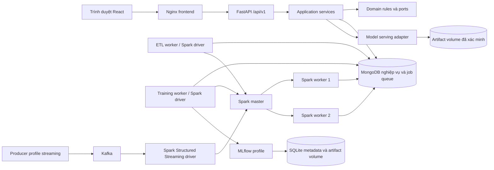
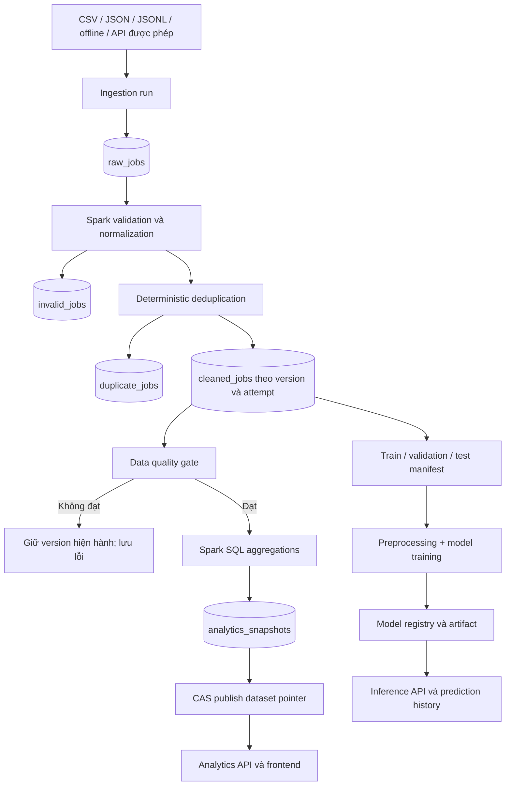

# Phase 1 — Yêu cầu và kiến trúc

## 1. Phạm vi và use cases

Mục tiêu: phân tích tập tin tuyển dụng đã thu thập và ước lượng lương tháng VND từ thông tin công việc. Thống kê chỉ đại diện cho dataset, nguồn và giai đoạn quan sát; không suy rộng thành toàn bộ thị trường lao động.

| ID | Yêu cầu chức năng | Người dùng | Kết quả |
| --- | --- | --- | --- |
| R01 | Upload CSV/JSON/JSONL, offline import | ADMIN | Dataset, ingestion run, raw records có nguồn gốc |
| R02 | Submit, theo dõi, retry và cancel ETL | ADMIN | Job bất đồng bộ; clean/invalid/duplicate; quality report |
| R03 | Công bố hoặc quay lại dataset version | ADMIN | Pointer nhất quán đến snapshot hoàn chỉnh |
| R04 | Lọc dashboard và danh sách tin | VIEWER, ANALYST, ADMIN | API truy vấn dataset version xác định |
| R05 | Huấn luyện, so sánh và active/rollback model | ADMIN | Baseline, regressors, metrics, model registry |
| R06 | Dự đoán và xem lịch sử cá nhân | ANALYST, ADMIN | Kết quả từ artifact active, lưu MongoDB |
| R07 | Kiểm tra trạng thái, logs và audit | ADMIN | Job progress, lỗi, request correlation |
| R08 | Nhận sự kiện Kafka qua Spark Streaming | ADMIN | Checkpoint, idempotent sink, recovery |
| R09 | Benchmark và xuất bằng chứng | ADMIN | Báo cáo có môi trường, số liệu đo và checksum |

Yêu cầu phi chức năng: pipeline chạy lại an toàn; API không huấn luyện hoặc chạy Spark trong request; pagination ở server; UTC cho timestamps; mọi kết quả gắn dataset/model/pipeline/code version. Secrets không commit/log. Health check phân biệt process sống và dependency sẵn sàng. Đo latency/throughput trên máy thực rồi mới đặt SLA, không cam kết số liệu chưa đo.

## 2. Kiến trúc cuối cùng

Backend modular monolith, theo Clean/Hexagonal Architecture. Router chỉ nhận/validate/map HTTP; application service điều phối domain rules qua ports; adapters triển khai MongoDB, Kafka, artifact serving. Domain không import FastAPI, PyMongo hay Spark. Worker ETL/training là process riêng, dùng chung kiểu dữ liệu và domain rules phù hợp, triển khai compute độc lập.





Luồng dependency: `api → application → domain`; application phụ thuộc interfaces trong `ports`; infrastructure composition root inject adapters. Job handlers gọi application service, không gọi HTTP ngược vào backend. MongoDB là job queue giai đoạn đầu để giảm hạ tầng; Kafka dành cho sự kiện tuyển dụng, không thay thế job ownership.

## 3. Quyết định công nghệ và tương thích

| Thành phần | Quyết định thiết kế | Kiểm chứng và điều kiện khóa phiên bản |
| --- | --- | --- |
| Spark/PySpark | 3.5.7, Scala 2.12, Java 17, Python 3.11 | Tài liệu Spark xác nhận Java 17 và Python 3.8+; driver/executor phải cùng Python, Spark và Scala ABI |
| Mongo Spark connector | `org.mongodb.spark:mongo-spark-connector_2.12:10.7.0` | MongoDB công bố hỗ trợ Spark 3.2–3.5, MongoDB ≥4.2; chạy round-trip test trước khóa build |
| Spark Kafka connector | `org.apache.spark:spark-sql-kafka-0-10_2.12:3.5.7` | Cùng phiên bản Spark và Scala; kiểm tra checkpoint/restart ở Phase 8 |
| MongoDB | Nhánh 8.0, PyMongo đồng bộ | Chọn patch cụ thể và digest tại Phase 2; API dùng sync endpoints/threadpool cho I/O blocking |
| API | FastAPI + Pydantic v2 + Settings, Python 3.11 | Resolve và pin toàn bộ lock tại Phase 2, chạy startup/schema/auth smoke test |
| Web | React + TypeScript + Vite, Node 24 build stage | Pin manifest/lock; React Router, TanStack Query, RHF/Zod, Tailwind/shadcn, ECharts, Lucide |
| ML | Spark MLlib + scikit-learn + XGBoost | Lock riêng training/serving; kiểm tra save/load và prediction parity |
| MLflow | Profile MLOps; SQLite backend, artifact volume | Metadata phụ trợ; MongoDB giữ business registry; một tracking server cho cấu hình đồ án |
| Kafka | Profile streaming, single-broker KRaft cho demo | Chọn patch/image digest Phase 2; single broker không có HA |
| Test | pytest/HTTPX, Vitest/RTL, Playwright | Khóa theo runtime; chạy integration trên services thật |

Đây là ma trận thiết kế, chưa phải bộ dependency đã resolve hoặc images đã build. Không tạo requirements/Compose có tag đoán trước. Phase 2 phải chọn patch cụ thể, kiểm tra release/support và scan dependencies trước build; giữ lockfile và image digest. Với PySpark standalone dùng **client deploy mode**: driver ở etl-worker/training-worker, executor ở spark-worker; driver hostname phải phân giải được từ executor.

Nguồn chính thức đã đối chiếu ngày 18/10/2026:

- [Spark 3.5.7: runtimes và cluster deployment](https://spark.apache.org/docs/3.5.7/).
- [MongoDB Spark connector compatibility](https://www.mongodb.com/docs/spark-connector/v10.x/).
- [Spark Kafka integration 3.5.7](https://spark.apache.org/docs/3.5.7/structured-streaming-kafka-integration.html).
- [MLflow backend stores](https://mlflow.org/docs/latest/tracking/backend-stores/) và [artifact stores](https://mlflow.org/docs/latest/self-hosting/architecture/artifact-store/). SQLite chỉ chứa metadata MLOps; không dùng MongoDB như backend MLflow mặc định.

## 4. Frontend sitemap và hành vi

| Route | Trang | API chính |
| --- | --- | --- |
| `/login` | Đăng nhập | `/auth/login`, `/auth/me` |
| `/` | Dashboard tổng quan | `/analytics/overview`, `/analytics/job-trends` |
| `/analytics/recruitment` | Ngành, địa phương, kinh nghiệm, kỹ năng, doanh nghiệp | Các `/analytics/*` tương ứng |
| `/analytics/salary` | Histogram, box plot, percentiles, so sánh | `/analytics/salary-distribution`, `/analytics/salary-by-*` |
| `/jobs` và `/jobs/:id` | Search, filter, phân trang, chi tiết/link nguồn | `/jobs`, `/jobs/filters/options`, `/jobs/{id}` |
| `/predictions` | Form dự đoán, lịch sử, model version | `/predictions/salary`, `/predictions/history` |
| `/datasets` và `/datasets/:id` | Upload, versions, quality, lỗi, download report | `/datasets/*`, `/ingestion-runs/*` |
| `/etl` và `/etl/:id` | Trạng thái, duration, counts, logs, retry/cancel | `/etl/jobs/*` |
| `/models` và `/models/:id` | Compare metrics, active/rollback, feature importance | `/models/*`, `/training/jobs/*` |
| `/settings` | Tài khoản, pipeline, quality, nguồn, service status | `/auth/me`, `/system/*` |

Layout sidebar/header/breadcrumb; màu chính #2563EB, nền #F5F8FC, surface #FFFFFF, text #172B4D. Mọi view có loading/empty/error/success; hỗ trợ bàn phím và nhãn form. TanStack Query polling job có backoff, dừng ở trạng thái terminal. Filter và pagination gửi về backend, có dataset version trong query key; biểu đồ thể hiện sample size, đơn vị, thời kỳ và nhãn DEMO khi có. Không tự sinh dữ liệu hay prediction trên frontend. Action bị từ chối quyền phải được backend kiểm soát dù nút đã ẩn.

## 5. Docker services và dependencies dự kiến

| Service | Vai trò và readiness | Persistent storage/profile |
| --- | --- | --- |
| mongodb | Auth bật; ping authenticated trước init | mongo-data; core |
| mongo-init | Tạo application user, validators/indexes; idempotent; exit 0 | core; backend/worker chờ hoàn tất |
| spark-master | Standalone master RPC/UI | event logs dùng volume riêng; core |
| spark-worker | Executor; đăng ký master trước ready | core, scale lên 2 cho bằng chứng phân tán |
| backend | API; ready khi Mongo và migration version đạt | read-only artifacts; core |
| etl-worker | Claim ETL/ingestion/report/benchmark jobs; Spark driver | uploads, event logs; core |
| training-worker | Claim training/evaluate jobs; Spark driver | artifacts; core, giới hạn concurrency 1 |
| frontend | Multi-stage Node build → Nginx; proxy `/api` sang backend | core; HTTP health |
| kafka | KRaft broker; topic metadata probe | kafka-data; streaming |
| streaming-worker | Structured Streaming driver | checkpoints; streaming |
| mlflow | HTTP tracking server | mlflow-db, mlflow-artifacts; mlops |

Network nội bộ cho Mongo/Spark/Kafka; chỉ frontend và dev ports được bind loopback host khi cần. Giao tiếp container dùng `mongodb`, `backend`, `spark-master`, `kafka`, `mlflow`; không dùng localhost giữa containers. Credentials qua môi trường/secrets, `.env.example` chỉ tên biến và giá trị không nhạy cảm; `.env` bỏ khỏi Git. Backend, frontend và workers chạy non-root; mongo-init dùng credential đủ quyền trong tác vụ một lần.

Health dependencies có retry ở application, vì thứ tự start không đảm bảo dịch vụ luôn sống. Restart `unless-stopped` cho long-running services. Persistent volumes cho raw files, MongoDB, artifacts, checkpoint và event logs. Backup Mongo và artifacts cùng manifest; restore sang project/volume riêng rồi kiểm tra hash và prediction parity trước sử dụng.

Ngân sách thử ban đầu (đề xuất, chưa đo): Docker Desktop/WSL2 cấp 12 GB RAM, 6 CPU, 20 GB đĩa trống; 2 worker × 1 core, executor memory 1 GB, driver 1 GB; không chạy ETL và training đồng thời. Máy ít tài nguyên dùng một worker để phát triển, nhưng phải chạy lại bằng hai worker khi thu bằng chứng. Nhiều container trên một máy chứng minh thực thi qua executor, không chứng minh mở rộng nhiều máy vật lý.

## 6. Cấu trúc dự kiến khi triển khai

```text
frontend/src/{app,pages,features,components,lib}
backend/src/recruitment/
  api/{v1,routers,schemas,dependencies}
  application/{use_cases,services,commands,queries}
  domain/{entities,value_objects,enums,exceptions,rules}
  ports/{repositories,messaging,model_serving,storage}
  adapters/{mongodb,kafka,mlflow,ml}
  infrastructure/{config,logging,security,monitoring}
  main.py
backend/tests/
bigdata/{ingestion,quality,schemas}
bigdata/spark/{batch,streaming,transformations,aggregations}
machine_learning/{datasets,features,training,evaluation,inference,registry}
workers/
infrastructure/{docker,mongo-init,kafka,mlflow}
scripts/
tests/{unit,integration,e2e,performance}
docs/
docker-compose.yml
docker-compose.streaming.yml
.env.example
```

Không tạo thư mục/module rỗng để coi như hoàn thành tính năng. Chỉ thêm abstraction có ít nhất một use case cụ thể.

## 7. Rủi ro và cách xử lý

| Rủi ro | Xử lý và điều kiện phát hiện |
| --- | --- |
| Thiếu dataset thật có giấy phép | Nhận file người dùng được phép sử dụng; lưu provenance/license; bộ seed DEMO tách riêng |
| Dữ liệu ít nhãn lương, lệch nguồn | Báo coverage và error theo nhóm; từ chối train khi quá ít nhóm/mẫu; không tuyên bố đại diện thị trường |
| Nhiều repost gây leakage | Dedup trước split; group company/job và temporal cutoff; lưu split manifest |
| Thiếu RAM khi benchmark | Chạy tăng dần 100 → 10k → 100k; 1m là tùy tài nguyên; lưu lần OOM thực tế |
| Artifact không tương thích hoặc bị thay | Lock môi trường, allowlist path, checksum; không load artifact do người dùng upload |
| Worker chết khi đang publish | Fencing token, attempt scope và CAS pointer; xem database/pipelines |
| Docker bị giới hạn truy cập trong phiên | Tách trạng thái thiết kế khỏi runtime; cung cấp lệnh và expected outcome, thu log thực khi môi trường cho phép |
