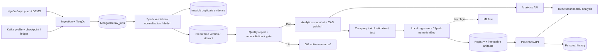

# Rà soát và nâng cấp bài toán nghiên cứu — 05/11/2026

## 1. Audit trước thay đổi

Đã lần theo upload → DatasetService → ingestion → transform/normalize → quality gate → published attempt → AnalyticsService → React; training → company split → registry → artifact serving/history. Không có AGENTS.md trong repository. Git working tree sạch khi bắt đầu.

| Hạng mục | Hiện trạng | Vấn đề | Phương án | File liên quan | Mức ưu tiên | Cách kiểm chứng |
| --- | --- | --- | --- | --- | --- | --- |
| Kiến trúc | API/worker riêng, attempt fencing, CAS publish | Không cần thiết kế lại | Giữ nguyên Compose, collections, routes, Kafka/MLflow tùy chọn | docker-compose*.yml, workers/, application/pipeline.py | Giữ | Config và integration tests |
| Nguồn | source/is_demo/hash/file_ref/created_at có sẵn | Thiếu metadata quyền sử dụng và thời kỳ; docs mô tả nhiều hơn source | Thêm metadata tùy chọn, không suy diễn giấy phép | datasets.py, api/data.py | P1 | Upload/idempotency tests |
| Kinh nghiệm | Thiếu được chuyển thành 0 | Nhầm chưa biết với không kinh nghiệm | Giữ null ở clean, encode missing tường minh ở ML; Spark numeric loại missing | normalize.py, features.py, training.py, spark_training.py | P0 | Missing/zero/invalid regression |
| Lương | Midpoint, FX provenance, NET bị loại ML | Kỳ hạn không hỗ trợ có thể thành tháng | Giữ parser và chặn kỳ hạn/currency không hỗ trợ; giải thích UNKNOWN basis | domain/salary.py | P0 | Salary tests |
| Chất lượng | Counts/validity/uniqueness/coverage có sẵn | consistency=1 hardcode; thiếu mẫu số và missing từng field | Đo quy tắc chéo; thêm missing/eligible/reconciliation | bigdata/etl.py | P0 | Quality/Spark fixture |
| Analytics | Published version/attempt + filters, snapshot và Mongo | Group thiếu median/quantile/cảnh báo; overview thiếu tỉnh/thời kỳ | Bổ sung trường tương thích và cùng ngữ nghĩa ở hai nhánh | analytics.py, etl.py | P1 | Filter/version/empty/group tests |
| ML local | 5 models cùng sample/split, chọn validation trước test | Chỉ slice tỉnh, nhóm nhỏ; manifest thiếu seed 43 và target rule | Giữ models/split, bổ sung 5 chiều slice và metadata | training.py | P1 | Split/metrics/diagnostics tests |
| Spark ML | Full train-company, experience only | Missing experience cần loại riêng; manifest chưa đầy đủ | Giữ thí nghiệm riêng, lưu membership/counts/eligibility | spark_training.py | P1 | Spark integration/parity |
| Benchmark | 27 observations và summary lịch sử còn trên host | Classifier benchmark riêng khác ETL khi invalid cùng key | Tái dùng classifier ETL; lưu partitions/job IDs; ghi rõ số đo cũ không thuộc code mới | benchmark.py | P0 | Checksum/count fixture; Docker benchmark |
| Giao diện | Loading/error/roles/filter/DEMO/metrics đã có | Thiếu câu hỏi, mẫu nhóm và giới hạn ở trang analysis | Bổ sung nội dung vào React hiện có | Workspace.tsx, ExtraReports.tsx | P1 | Frontend unit/build; browser |
| Tài liệu | Có architecture/pipelines/database/phase reports | Một số thiết kế được mô tả như implementation (temporal, GBT, Decimal128, connector default) | Sửa theo source, tách lịch sử với lần kiểm tra mới | docs/, README.md | P1 | Đối chiếu source và artifacts |

## 2. Môi trường khi bắt đầu

- Docker CLI có nhưng daemon `//./pipe/docker_engine` không tồn tại; config Docker user cũng không đọc được trong sandbox. Không chạy kill/restart/recovery hoặc sửa volumes.
- `.venv` cũ trỏ Python Store 3.12 từ thư mục DoAnCuoiKy và không tạo được process.
- Python host 3.13 chạy được; thiếu pytest/scikit-learn/PySpark/FastAPI/XGBoost. Đây không phải môi trường Linux 3.11 đã khóa.
- `artifacts/benchmark-{environment,observations,summary}` và source archive còn tồn tại; kết quả lịch sử được kiểm tra riêng, không ghi nhận là benchmark mới.

## 3. Problem Definition

**Bài toán:** xây dựng hệ thống chuẩn hóa và phân tích các tin tuyển dụng quan sát được, ước lượng midpoint lương công bố theo tháng VND từ đặc điểm công việc và kiểm chứng workload Spark bằng phép đo có đối soát.

Đối tượng sử dụng: VIEWER xem thống kê; ANALYST khảo sát và dự đoán; ADMIN quản lý nguồn, ETL và model. Input gồm CSV/JSON/JSONL có nguồn, thời kỳ (nếu biết), quyền sử dụng khai báo và DEMO flag; X chỉ gồm thông tin công việc trước khi biết lương. Output gồm raw/clean/invalid/duplicate có version, quality report, statistics có mẫu số/bộ lọc, model evaluation và prediction có provenance.

Câu hỏi: ngành/tỉnh/kỹ năng nào xuất hiện nhiều tin trong dataset? Kinh nghiệm và lương công bố đồng biến thế nào trong mẫu? Phân bố lương và số tin theo thời gian ra sao? Local regressors có validation MAE tốt hơn median baseline trên cùng split không? Sai số thay đổi ở nhóm nào đủ mẫu? Cùng output, local một luồng và cluster một/hai executor có khác biệt thời gian/throughput thế nào?

Mục tiêu kiểm chứng: đối soát đủ raw thành ba terminal outcomes; không giao company/source key giữa split; preprocessing chỉ fit train; chốt winner trên validation; test IDs chung trong thí nghiệm local; ít nhất ba lần đo sau warm-up mỗi cấu hình/quy mô. Không hứa trước R² hay speedup. H1 (model hơn baseline) và H2 (cluster có lợi khi workload đủ lớn) là giả thuyết, chưa có bằng chứng mới trên nguồn thực.

Nhãn y: midpoint hai bounds dương, hữu hạn, đúng thứ tự sau FX/kỳ hạn có provenance. Một phía/không công khai/không chuyển đổi được → null; không biến thành 0. NET bị loại ML; UNKNOWN basis còn lại là hạn chế. Dữ liệu không có nhãn vẫn tham gia analytics số tin. [Định nghĩa và phương pháp đầy đủ](../architecture.md), [quy tắc pipeline](../pipelines.md).

## 4. Architecture & Data Flow

Giữ Compose, Mongo validators/indexes, routing, authentication/roles và worker queue/fencing. ETL mặc định đọc raw JSONL, không phải Mongo connector. Spark numeric là thí nghiệm scale khác features/eligibility/count; không suy khác biệt thuật toán từ so sánh trực tiếp với local models. Streaming là ingestion mở rộng rồi dùng ETL chuẩn.

## 5. Change Summary

| File | Thay đổi | Lý do | Chức năng liên quan | Test |
| --- | --- | --- | --- | --- |
| bigdata/normalize.py | Missing experience giữ null; invalid không đổi 0 | Phân biệt chưa biết và không kinh nghiệm | ETL/ML/analytics | T1 salary regressions |
| backend/src/recruitment/domain/salary.py | Không gán kỳ hạn WEEK/weekly thành MONTH | Bảo vệ ý nghĩa target | Salary normalization | T1 salary |
| backend/src/recruitment/application/datasets.py | Thêm metadata tùy chọn, filename/schema; conflict cả metadata/source/DEMO | Truy vết và idempotency nhất quán | Ingestion | T1 metadata API; Mongo idempotency BLOCKED |
| backend/src/recruitment/api/data.py | Validate metadata JSON, dates/permission; request cũ vẫn được nhận | Provenance không suy diễn | Upload API | T1 HTTP validation |
| bigdata/quality.py | Ratios/mẫu số/missing/reconciliation thuần Python | Thay hardcode và tách quy tắc dễ kiểm tra | Quality reporting | T1 quality |
| bigdata/etl.py | Đo consistency/eligibility/missing; snapshot schema 2; group quantiles; classifier dùng chung | Chất lượng và thống kê có thể giải thích | ETL/analytics/benchmark | Spark regressions BLOCKED; syntax PASS |
| backend/src/recruitment/application/analytics.py | Group median/quantiles/warnings; reference period; legacy snapshot live fallback | Không trộn version, không xếp hạng mẫu nhỏ | Analytics API | T2 group rules PASS; Mongo aggregation BLOCKED |
| machine_learning/features.py | Numeric sentinel cùng missing indicator, không sửa null ở clean | Missing khác 0 năm | dict-v2 preprocessing | T3 |
| machine_learning/evaluation.py | 5 chiều error slices, min 30, suppressed counts | Không diễn giải sai số từ vài mẫu | ML diagnostics | T3 |
| machine_learning/training.py | Manifest đầy đủ seeds/counts/target/basis; source-key leakage check; slices | Tái lập và độc lập holdout | 5 local models | T3 fit thật và artifact roundtrip |
| machine_learning/spark_training.py | Loại missing numeric riêng; manifest/holdout/plots | Giữ riêng thí nghiệm scale | Spark MLlib | Spark runtime BLOCKED; syntax PASS |
| machine_learning/plots.py | Nhận named coefficients cho numeric model | Dùng chung diagnostics hiện có | Scatter/residual/importance | Local fit/artifacts PASS; Spark BLOCKED |
| machine_learning/serving.py | OOD categories dict-v2, thiếu observed range có warning | Diễn giải phạm vi huấn luyện | Prediction/history | T3 provenance/OOD with test doubles |
| bigdata/benchmark.py | Classifier ETL thật, hashes/partitions/stages/tasks, restore env | Workload nhất quán và tái lập | Benchmark schema 2 | New Spark run BLOCKED |
| scripts/verify_benchmark_evidence.py | Đối soát observations/summary/hash archive | Kiểm tra bằng chứng cũ, không giả đo mới | Experimental evidence | T4 historical verification PASS |
| backend/src/recruitment/api/reports.py | Trả error slices/policy đủ mẫu | Trình bày chẩn đoán từ dữ liệu thật | Diagnostics API | Syntax PASS; Mongo route integration BLOCKED |
| frontend/src/Workspace.tsx | Câu hỏi, context/missing/unit/sample, metadata form, model groups/MedAE, prediction meaning | Gắn UI với bài toán | Trang hiện có | T5 unit/build/browser fixture |
| frontend/src/ExtraReports.tsx | Residual histogram, slice table, importance caveat, loading/error | Hiển thị đánh giá đã lưu | ML diagnostics | Build PASS; model API E2E BLOCKED |
| frontend/e2e/research.spec.ts; frontend/playwright.research.config.ts | UI fixture riêng, không dùng credentials thật | Kiểm tra nội dung và mobile khi Docker tắt | UI regression | 2 browser tests PASS |
| tests/test_salary.py; test_ml.py; test_research_quality.py; test_research_analytics.py; test_source_metadata_api.py | Bổ sung regression/data/ML/HTTP validation tests | Kiểm tra thay đổi P0/P1 | T1/T2/T3/T5 | 41 Python cases PASS (gồm tests config cũ) |
| tests/test_etl.py; tests/test_ingestion.py | Fixture invalid cùng key, external duplicate, missing experience, metadata conflict | Phát hiện classifier và retry/idempotency lệch | Spark/Mongo integration | BLOCKED |
| README.md; docs/architecture.md; docs/pipelines.md; docs/database.md; docs/api-contract.md; docs/openapi.json | Thống nhất bài toán, nguồn, target, quy tắc và source runtime | Xóa nhầm lẫn thiết kế/chức năng đã triển khai | Báo cáo và sử dụng | Source/schema comparison PASS |
| docs/reports/benchmark.md; phase-9.md; research-upgrade.md | Gắn mốc bằng chứng lịch sử và nghiệm thu mới | Không gán số đo cũ cho code mới | Evidence/handover | Audit |

## 6. Experimental Evidence

**Lần kiểm tra mới:** Python host 3.13; thư viện test cài riêng vào `artifacts/audit-deps`, không sửa `.venv` cũ hay runtime lock. scikit-learn 1.6.1, XGBoost 2.1.4, FastAPI 0.115.12, pytest 8.3.5; transitive dependencies là bản host, khác production lock. Đây là môi trường hỗ trợ kiểm thử, không thay thế kiểm chứng Docker Linux 3.11.

- T1/T2: unit fixtures kiểm tra salary parsing, null/zero/invalid experience, mẫu số quality và suppression quantile. HTTP TestClient kiểm tra metadata thật ở tầng validation, với auth/storage test doubles; chưa kiểm tra persist Mongo.
- T3: fit thật Dummy/Ridge/Random Forest/Gradient Boosting/XGBoost trên fixture 400 rows/40 company groups. Assertions kiểm tra manifest chung, winner validation, test IDs, metrics tính lại từ holdout và prediction parity sau joblib load. Mongo storage và Spark step dùng test doubles; không ghi đây là training E2E hay chất lượng mô hình thị trường. Không công bố accuracy/benchmark tự sinh ngoài phép kiểm tra.
- T4: `python scripts/verify_benchmark_evidence.py` xác minh 27 observations = 3 cấu hình × 3 quy mô × 3 lặp; raw counts và fingerprint khớp; throughput, median/min/max/speedup tính lại khớp summary; hash ETL+normalize trong source archive khớp environment lịch sử.
- T5: Chrome chạy React/Vite với API fixture có nhãn TEST/DEMO, kiểm tra metadata, thiếu nhãn 95% của fixture, cảnh báo nhóm dưới 30, filter, lỗi/retry, mobile 390 px không tràn toàn trang. Đã xem screenshot mobile. Fixture không phải dữ liệu thị trường hoặc E2E backend.
- Cấu hình Compose core và core+streaming+MLflow qua `config --quiet` đều PASS, không cần daemon. Kiểm tra 54 Python files bằng compile trong bộ nhớ, OpenAPI snapshot khớp source, giữ đủ 36 route paths và required upload fields; chỉ thêm source_metadata tùy chọn.

**Bằng chứng lịch sử:** ngày 18/10/2026, DEMO 100/10k/100k; median local[1] lần lượt 0,644/0,999/4,086 giây, cluster hai executors 0,772/1,172/2,805 giây, speedup 100k khoảng 1,46×. Nguồn: observations/summary/environment trong artifacts và [phương pháp cũ](benchmark.md). Timer gồm read/normalize/window/aggregate, không gồm upload/Mongo write/training/startup. Đây là nhiều containers cùng máy, OS cache không kiểm soát hoàn toàn. Chỉ kết luận đúng phạm vi thí nghiệm cũ.

Benchmark schema 2 đã thay classifier/checksum/workload nên **chưa có timing mới**; không tái sử dụng số đo cũ như hiệu năng code mới. Chưa đo 1 triệu rows, peak RAM, cluster nhiều máy, Mongo query optimization mới, recovery/restart hoặc streaming/MLflow của source nâng cấp.

Evidence mới (ignored, không chứa credentials): `artifacts/upgrade-unit.xml`, `upgrade-t1-t2.xml`, `upgrade-t3.xml`, `upgrade-browser.xml`, `upgrade-benchmark-verification.json`, `upgrade-static.json`, `upgrade-salary-{desktop,mobile}.png`. Tests và script đối soát được giữ trong Git để tái lập; artifacts cục bộ cần lưu kèm khi bàn giao.

## 7. Test Report và các vòng sửa

| Test ID | Mục tiêu | Input | Expected | Actual | Trạng thái | Evidence |
| --- | --- | --- | --- | --- | --- | --- |
| T1 | Salary/missing/quality/provenance | Giá trị thiếu/0/invalid, lương nhiều kỳ, counts fixture, metadata JSON | Không gán nhãn giả; ratios/mẫu số đúng; legacy upload hợp lệ | Assertions đạt | PASS | upgrade-unit.xml; bảng từng case bên dưới |
| T2-unit | Group salary statistics | n=0/2/30, percentiles fixture | Median mô tả; quantiles chỉ n≥30; missing rate đúng | Assertions đạt | PASS | upgrade-unit.xml |
| T2-Mongo | Filter/version/empty và quantiles từ engine | tests/test_analytics.py | Không trộn version, counts/statistics đúng | Chưa chạy, không có Mongo/Docker daemon | BLOCKED | Docker preflight; test source |
| T3-local | Split/metrics/real fits/save-load/OOD | 400 rows/40 groups + known metric fixtures | Cùng IDs, không leakage, validation selection, artifact parity | 6 ML test functions đạt | PASS | upgrade-t3.xml; upgrade-unit.xml |
| T3-Spark | Numeric training/parity | Published clean + observed experience | Đúng eligibility/groups/counts/artifacts | Chưa chạy do Docker/PySpark runtime thiếu | BLOCKED | spark_training.py; Docker preflight |
| T4-historical | Bằng chứng benchmark cũ | 27 observations/9 summary rows + archive | Counts/checksum/arithmetic/source hash khớp | Khớp tất cả | PASS | upgrade-benchmark-verification.json |
| T4-new | Classifier/task/partition/runtime determinism | tests/test_etl.py + benchmark schema 2 | Outcomes khớp, output không đổi giữa lặp/cấu hình | Chưa chạy Spark | BLOCKED | test_etl.py; benchmark.py |
| T4-Mongo | Write/index/retry/export isolation | Mongo integration tests | Version/attempt/idempotency đúng | Chưa có DB test | BLOCKED | tests/test_ingestion.py, test_attempt_reports.py |
| T5-unit | Auth UI/refresh regression | Frontend unit fixtures | Error login/refresh xử lý đúng | 2 tests đạt | PASS | npm frontend test |
| T5-build | TypeScript và production assets | React source | Build thành công | tsc + Vite thành công; ECharts chunk warning còn | PASS | npm frontend run build |
| T5-browser-fixture | Scope/DEMO/samples/filter/error/mobile | React + TEST API fixture | Nội dung đúng, retry hiện, không tràn 390 px | 2 tests đạt | PASS | upgrade-browser.xml; PNGs |
| T5-contract | API/Compose/syntax compatibility | Source + HEAD OpenAPI + Compose profiles | Không mất route/required fields, config parse được | 36 paths giữ nguyên; 54 Python files compile; 2 Compose configs hợp lệ | PASS | upgrade-static.json; config --quiet |
| T5-E2E | Backend–Mongo–workers–Spark–UI thật, roles/recovery/persistence | Docker stack và dữ liệu test riêng | Workflow và chức năng cũ hoạt động | Daemon pipe không tồn tại | BLOCKED | scripts/e2e.py, verify_runtime.py, failure_recovery.py chưa chạy |

Vòng sửa T1: 1 vòng code — hàm text(value or '') coi số 0 là rỗng; đổi kiểm tra missing sang None/string blank, regression 0 năm đạt. T3: 0 vòng sửa thuật toán; 2 lần sửa cấu hình test host — cung cấp dummy settings thay `.env` Compose và đặt pytest temp dưới workspace thay thư mục Temp bị chặn; sau đó local training test đạt. Syntax check ban đầu không ghi được bytecode vào cache cũ; chuyển sang compile trong bộ nhớ, không sửa code để lách lỗi. Không giai đoạn nào vượt 3 vòng sửa. Không có FAIL còn lại trong các tests đã chạy; các mục BLOCKED chưa được nghiệm thu runtime.

Warnings còn lại: Starlette/AnyIO và Matplotlib/PyParsing deprecations trong test host; ECharts chunk >500 kB. Chưa tối ưu bundle vì không ảnh hưởng mục tiêu tính đúng đắn và không có phép đo tải ứng dụng mới.

### Từng testcase Python đã chạy

| Test ID | Mục tiêu | Input | Expected | Actual | PASS/FAIL/BLOCKED | Evidence |
| --- | --- | --- | --- | --- | --- | --- |
| T1-01 | `test_salary` | [10\u201315 tri\u1ec7u VND/th\xe1ng-12500000-VALID_RANGE] | Midpoint/status khớp fixture | Assertions đạt | PASS | upgrade-unit.xml::1 |
| T1-02 | `test_salary` | [20 tri\u1ec7u/th\xe1ng-20000000-VALID_RANGE] | Midpoint/status khớp fixture | Assertions đạt | PASS | upgrade-unit.xml::2 |
| T1-03 | `test_salary` | [1.000 USD/th\xe1ng-None-FX_REQUIRED] | Midpoint/status khớp fixture | Assertions đạt | PASS | upgrade-unit.xml::3 |
| T1-04 | `test_salary` | [15\u201320 USD/gi\u1edd-None-FX_REQUIRED] | Midpoint/status khớp fixture | Assertions đạt | PASS | upgrade-unit.xml::4 |
| T1-05 | `test_salary` | [Up to 30 tri\u1ec7u-None-ONE_SIDED] | Midpoint/status khớp fixture | Assertions đạt | PASS | upgrade-unit.xml::5 |
| T1-06 | `test_salary` | [From 15 tri\u1ec7u-None-ONE_SIDED] | Midpoint/status khớp fixture | Assertions đạt | PASS | upgrade-unit.xml::6 |
| T1-07 | `test_salary` | [Negotiable-None-UNDISCLOSED] | Midpoint/status khớp fixture | Assertions đạt | PASS | upgrade-unit.xml::7 |
| T1-08 | `test_salary` | [Competitive-None-UNDISCLOSED] | Midpoint/status khớp fixture | Assertions đạt | PASS | upgrade-unit.xml::8 |
| T1-09 | `test_salary` | [30\u201310 tri\u1ec7u-None-REVERSED_RANGE] | Midpoint/status khớp fixture | Assertions đạt | PASS | upgrade-unit.xml::9 |
| T1-10 | `test_salary` | [240 tri\u1ec7u VND/n\u0103m-20000000-VALID_RANGE] | Midpoint/status khớp fixture | Assertions đạt | PASS | upgrade-unit.xml::10 |
| T1-11 | `test_salary` | [-10 tri\u1ec7u-None-INVALID_VALUE] | Midpoint/status khớp fixture | Assertions đạt | PASS | upgrade-unit.xml::11 |
| T1-12 | `test_normalization_preserves_key_and_unknown_salary` | Fixture: tests.test_salary.py | Các assertions của fixture đạt | Assertions đạt | PASS | upgrade-unit.xml::12 |
| T1-13 | `test_fx_and_hour_assumptions_have_provenance` | Fixture: tests.test_salary.py | Các assertions của fixture đạt | Assertions đạt | PASS | upgrade-unit.xml::13 |
| T1-14 | `test_invalid_currency_type_is_quarantined_instead_of_crashing_spark` | Fixture: tests.test_salary.py | Các assertions của fixture đạt | Assertions đạt | PASS | upgrade-unit.xml::14 |
| T1-15 | `test_missing_experience_remains_unknown` | [None] | Thiếu khác 0; invalid quarantine; split tái lập | Assertions đạt | PASS | upgrade-unit.xml::15 |
| T1-16 | `test_missing_experience_remains_unknown` | [] | Thiếu khác 0; invalid quarantine; split tái lập | Assertions đạt | PASS | upgrade-unit.xml::16 |
| T1-17 | `test_missing_experience_remains_unknown` | [   ] | Thiếu khác 0; invalid quarantine; split tái lập | Assertions đạt | PASS | upgrade-unit.xml::17 |
| T1-18 | `test_invalid_experience_is_quarantined` | [-1] | Thiếu khác 0; invalid quarantine; split tái lập | Assertions đạt | PASS | upgrade-unit.xml::18 |
| T1-19 | `test_invalid_experience_is_quarantined` | [61] | Thiếu khác 0; invalid quarantine; split tái lập | Assertions đạt | PASS | upgrade-unit.xml::19 |
| T1-20 | `test_invalid_experience_is_quarantined` | [nan] | Thiếu khác 0; invalid quarantine; split tái lập | Assertions đạt | PASS | upgrade-unit.xml::20 |
| T1-21 | `test_invalid_experience_is_quarantined` | [infinity] | Thiếu khác 0; invalid quarantine; split tái lập | Assertions đạt | PASS | upgrade-unit.xml::21 |
| T1-22 | `test_invalid_experience_is_quarantined` | [not a number] | Thiếu khác 0; invalid quarantine; split tái lập | Assertions đạt | PASS | upgrade-unit.xml::22 |
| T1-23 | `test_invalid_experience_is_quarantined` | [True] | Thiếu khác 0; invalid quarantine; split tái lập | Assertions đạt | PASS | upgrade-unit.xml::23 |
| T1-24 | `test_zero_experience_and_unsupported_pay_period` | Fixture: tests.test_salary.py | Thiếu khác 0; invalid quarantine; split tái lập | Assertions đạt | PASS | upgrade-unit.xml::24 |
| T1-25 | `test_quality_denominators_reconciliation_and_missing` | Fixture: tests.test_research_quality.py | Mẫu số/reconciliation và null đúng | Assertions đạt | PASS | upgrade-unit.xml::25 |
| T1-26 | `test_empty_quality_is_not_perfect_quality` | Fixture: tests.test_research_quality.py | Mẫu số/reconciliation và null đúng | Assertions đạt | PASS | upgrade-unit.xml::26 |
| T1-27 | `test_provenance_does_not_invent_permission_or_observation_dates` | Fixture: tests.test_research_quality.py | Các assertions của fixture đạt | Assertions đạt | PASS | upgrade-unit.xml::27 |
| T2-28 | `test_group_statistics_small_samples_and_zero_labels` | Fixture: tests.test_research_analytics.py | Median/missing rate/min 30 đúng | Assertions đạt | PASS | upgrade-unit.xml::28 |
| T3-29 | `test_no_label_leakage_and_group_split` | Fixture: tests.test_ml.py | Các assertions của fixture đạt | Assertions đạt | PASS | upgrade-unit.xml::29 |
| T3-30 | `test_missing_experience_is_a_distinct_feature_and_split_is_reproducible` | Fixture: tests.test_ml.py | Thiếu khác 0; invalid quarantine; split tái lập | Assertions đạt | PASS | upgrade-unit.xml::30 |
| T3-31 | `test_error_slices_require_samples_and_include_all_dimensions` | Fixture: tests.test_ml.py | Các assertions của fixture đạt | Assertions đạt | PASS | upgrade-unit.xml::31 |
| T3-32 | `test_prediction_preserves_provenance_and_warns_outside_training` | Fixture: tests.test_ml.py | Provenance/OOD/feature allowlist đúng | Assertions đạt | PASS | upgrade-unit.xml::32 |
| T3-33 | `test_local_training_candidates_share_manifest_and_select_on_validation` | Fixture: tests.test_ml.py | 5 fits cùng IDs, validation winner, artifact parity | Assertions đạt | PASS | upgrade-unit.xml::33 |
| T3-34 | `test_known_metrics_and_artifact_roundtrip` | Fixture: tests.test_ml.py | MAE/RMSE đúng; prediction parity | Assertions đạt | PASS | upgrade-unit.xml::34 |
| T5-35 | `test_secrets_are_masked` | Fixture: tests.test_config.py | Các assertions của fixture đạt | Assertions đạt | PASS | upgrade-unit.xml::35 |
| T5-36 | `test_missing_secret_fails_configuration` | Fixture: tests.test_config.py | Các assertions của fixture đạt | Assertions đạt | PASS | upgrade-unit.xml::36 |
| T1-37 | `test_upload_metadata_http_validation_preserves_legacy_request` | [None-202] | 202/422 đúng fixture, validation trước storage | Assertions đạt | PASS | upgrade-unit.xml::37 |
| T1-38 | `test_upload_metadata_http_validation_preserves_legacy_request` | [{"source_type":"synthetic","license_permission":"TEST ONLY","collected_at":"2026-01-01"}-202] | 202/422 đúng fixture, validation trước storage | Assertions đạt | PASS | upgrade-unit.xml::38 |
| T1-39 | `test_upload_metadata_http_validation_preserves_legacy_request` | [not JSON-422] | 202/422 đúng fixture, validation trước storage | Assertions đạt | PASS | upgrade-unit.xml::39 |
| T1-40 | `test_upload_metadata_http_validation_preserves_legacy_request` | [{"observation_from":"2026-02-01","observation_to":"2026-01-01"}-422] | 202/422 đúng fixture, validation trước storage | Assertions đạt | PASS | upgrade-unit.xml::40 |
| T1-41 | `test_metadata_is_additive_and_prediction_inputs_forbid_target` | Fixture: tests.test_source_metadata_api.py | Provenance/OOD/feature allowlist đúng | Assertions đạt | PASS | upgrade-unit.xml::41 |

PASS của fixture/test doubles không thay các mục Mongo/Spark/E2E BLOCKED ở bảng tổng hợp.

## 8. Limitations và nghiệm thu

**Trạng thái: chưa ACCEPT toàn bộ.** Phần code/tài liệu và kiểm thử local đã hoàn thành trong phạm vi trên; acceptance cần chạy lại Spark/Mongo/E2E với Docker. Không dùng PASS của phase-9 cũ để thay thế tests source mới.

DEMO IT seed 42 có công thức sinh dữ liệu; kết quả tốt có thể chỉ học quy luật generator. Chưa có nguồn thực được cấp phép, chưa có bằng chứng đại diện thị trường, temporal holdout, calibrated interval, ablation thực nghiệm, external validation hoặc multi-machine benchmark. Group company + source-key check không phát hiện mọi repost khác ID/doanh nghiệp. Source metadata do người nhập khai báo, không chứng nhận pháp lý. UNKNOWN salary basis và selection bias từ công khai lương hạn chế ý nghĩa target. Group min 30 là guardrail, không phải kiểm định thống kê. Percentiles xấp xỉ khác engine có thể lệch; snapshot cũ được live-query nên có chi phí truy vấn chưa đo lại.

Mở rộng có điều kiện: nguồn thực có quyền → kiểm tra taxonomy/locale, temporal evaluation và ablation cùng manifest; kiểm chứng calibration trước thêm interval; đo workload schema 2 trước kết luận hiệu năng; profiling Mongo cùng filter/data/cache trước thay index. Không tự thu thập dữ liệu, bật profiles, sửa schema hay chạy recovery trong phiên này.

## 9. Hướng dẫn demo và tái lập

1. Khởi động Docker Desktop Linux containers/WSL2. Tại repository chạy `powershell -NoProfile -ExecutionPolicy Bypass -File scripts/setup.ps1` (giữ `.env` và volumes hiện có). Kiểm tra `docker compose ps` và readiness tại `http://localhost:8080/api/v1/health/ready`.
2. Sinh DEMO bằng `python scripts/generate_demo.py --rows 1000 --output data/DEMO-research.csv` hoặc chọn file DEMO hiện có; không gọi đó là dữ liệu thật. Đăng nhập `http://localhost:8080` bằng tài khoản cấu hình cục bộ.
3. Quản lý dữ liệu: upload file, source và DEMO; nhập quyền/thời kỳ nếu biết, không điền giả. Đợi RAW_READY, submit ETL. Theo dõi raw/invalid/duplicate/clean và quality definitions; chỉ tiếp tục khi PUBLISHED. Lưu dataset/attempt IDs.
4. Dashboard: chọn version, tỉnh/ngành/ngày; xem tổng tin, nhãn lương/thời kỳ. Trang phân tích: đọc câu hỏi, mẫu số, trung vị và cảnh báo ít mẫu. Export CSV đối soát đúng attempt nếu cần.
5. ML: chọn published version có ≥200 labels và ≥10 company groups; training worker tạo 5 local candidates và Spark numeric riêng (Spark còn cần đủ observed-experience samples). Xem validation winner, baseline cùng test, manifests, residuals và đủ-mẫu slices. Không chọn lại model chỉ vì test thấp hơn.
6. Active model phù hợp validation gate; gửi form dự đoán. Giải thích lương công bố, test MAE, model/dataset version, reference period, DEMO/OOD warnings; kiểm tra history. Không nói đây là lương thị trường hay độ tin cậy xác suất.
7. Kiểm chứng backend: `docker compose run --rm test-backend`. Spark: `docker compose exec -e RUN_SPARK_TESTS=1 -e MONGO_DATABASE=recruitment_test etl-worker python -m pytest -q tests/test_etl.py`. Bộ Spark hiện có 3 tests; không chấp nhận skipped thay PASS.
8. Khi hai executors không bị workload khác chiếm, chạy `docker compose exec etl-worker python -m bigdata.benchmark --sizes 100 10000 100000 --repeats 3`. Lưu source/input hashes, plans, event logs, task metadata và observations; không tăng lên 1 triệu trong demo mặc định. Nếu streaming đang dùng tài nguyên, chủ động dừng profile trong cửa sổ demo đã chọn trước.
9. Frontend: `npm.cmd --prefix frontend test`, `npm.cmd --prefix frontend run build`. Browser fixture riêng: từ frontend chạy `npx.cmd playwright test --config playwright.research.config.ts` (cần Chrome; config tự dùng/start Vite). Đây không thay E2E thật: `python scripts/e2e.py --rows 1000` và browser app.spec khi stack sẵn sàng.

Không tự chạy scripts kill/restart/restore khi có công việc khác. Kafka/MLflow tùy chọn theo README; không cần bật cho phân tích batch cơ bản.

## 10. Kịch bản bảo vệ 14 phút

| Thời gian | Nội dung | Bằng chứng trình bày |
| --- | --- | --- |
| 0:00–1:30 | Bài toán A/B/C, người dùng, input/output và phạm vi quan sát | architecture.md; nói rõ không đo toàn thị trường |
| 1:30–3:00 | DEMO/nguồn/thời kỳ/quyền sử dụng; target và selection bias | Dataset metadata, raw payload, salary rules |
| 3:00–5:30 | Spark ETL, null khác 0, invalid/dedup, quality gate và publish | Job/attempt, raw=clean+invalid+duplicate, reports/export |
| 5:30–7:30 | Câu hỏi analytics, filters, salary coverage, median và mẫu nhỏ | Dashboard, trang ngành/tỉnh/kinh nghiệm; không suy nhân quả |
| 7:30–10:30 | Company split, baseline/candidates, validation winner, holdout/slices | Manifest, model registry, scatter/residual/importance caveat |
| 10:30–12:00 | Prediction + history và provenance/OOD | Một form request thật khi stack sẵn sàng; không có interval giả |
| 12:00–13:00 | Big Data evidence | Benchmark lịch sử có mốc/source; chỉ dùng kết quả schema 2 nếu đã chạy mới |
| 13:00–14:00 | Đóng góp tích hợp, hạn chế và phần chưa kiểm chứng | Bảng PASS/BLOCKED; DEMO không chứng minh generalization |

Nếu Docker vẫn không chạy, trình bày source/tests/ảnh fixture và nói rõ không demo live; không dùng screenshot fixture để khẳng định pipeline thật đang hoạt động.
